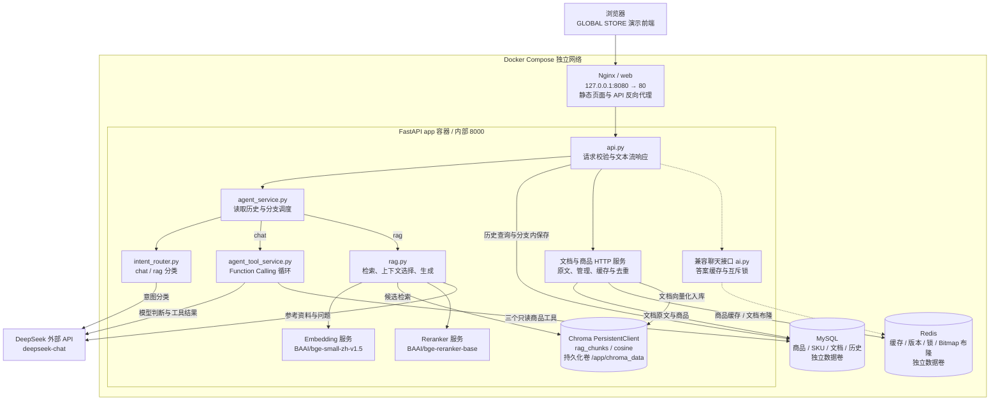
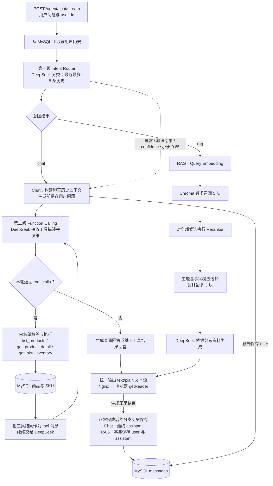
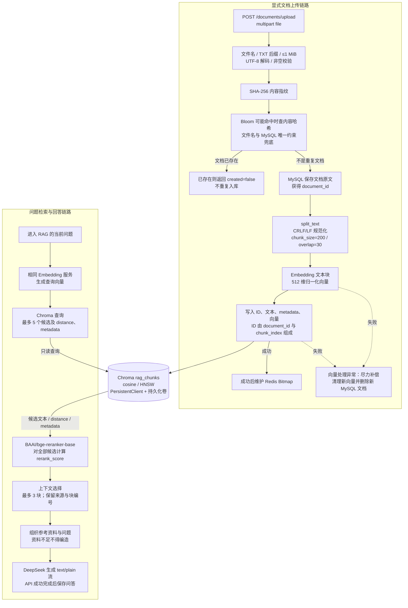

# MERIDIAN 系统架构

**MERIDIAN — Commerce Intelligence Platform** 是平台产品名称；GLOBAL STORE 是演示店铺。本文依据当前源码描述实际调用关系，不代表未来规划。

[返回项目主页](../README.md) · [Docker 部署](deployment.md)

## 图一：系统整体架构

图中实线表示主要调用或数据读写，虚线表示兼容接口的独立使用路径。DeepSeek 是外部服务，Embedding、Reranker 和 Chroma PersistentClient 在 app 内运行；模型文件通过只读缓存提供。

职责边界：

- `agent_service.py` 只负责一级结果后的调度，Chat 内部的工具判断由 `agent_tool_service.py` 执行。
- 商品工具直接调用业务服务/ORM 查询，不经过商品 HTTP API 的 Redis 缓存。
- Redis 并不参与所有 Agent 请求：文档去重、商品 HTTP 缓存和兼容聊天缓存/锁是不同使用路径。
- Chroma 不是独立 HTTP 服务；模型缓存不是向量索引，二者使用不同挂载位置。
- Nginx 对文本流关闭代理缓冲；响应按原 `text/plain` 协议返回，不封装 SSE 事件。

## 图二：Agent 两级决策工作流

实现细节：

- Router 只允许 `chat`、`rag`；历史每条最多保留 1500 字符，置信度阈值为 0.65。当前问题明确切换话题时优先使用当前问题。
- Chat 的生成上下文由 `ai.build_messages()` 构建：最近最多 20 条、总计最多 20000 个历史字符，并保留当前问题。Function Calling 有最大轮数/调用次数保护，图中省略了错误和上限分支。
- RAG 生成使用“当前问题 + 检索资料”；此路径并没有把完整聊天历史直接拼入 RAG 生成消息。历史在一级意图判断中仍然发挥作用。
- 图中的“统一”指响应协议一致，不是新增一个公共保存事务。Chat 先提交用户消息，失败时可能只留下用户问题；RAG 只有完整回答生成后才用 `save_conversation()` 一次提交问答对。
- 工具轮次中的模型文本片段也会累积到同一响应；图展示主要决策过程，省略逐个 delta 的输出细节。
- 没有候选或没有有效重排结果时，RAG 返回资料不足说明；并不强行调用 DeepSeek 编造回答。

对应源码：[调度](../agent_service.py)、[分类](../intent_router.py)、[工具循环](../agent_tool_service.py)、[工具注册](../agent_tools.py)、[RAG](../rag.py)、[历史保存](../database.py)。

## 图三：RAG 文档入库与检索流程

检索与一致性说明：

图中的共享 Chroma 节点表示数据读写关系，不表示上传会自动触发用户问答。

1. **5 与 3 是不同阶段的上限。** Chroma 用 `min(5, collection.count())` 召回；Reranker 处理全部候选，上下文选择后最多保留 3 块，候选不足不会复制补齐。
2. 一般问题优先保持重排相关性；明确政策问题结合标题/filename 主题匹配，综合架构问题结合总览和缺失事实覆盖。选择规则不硬编码文档 ID 或 chunk ID，也不修改原始 Reranker 分数。
3. 当前没有 RAG 相关性分数阈值。Router 的 confidence 阈值与 Reranker 分数不是同一概念。
4. 文本 metadata 包含 `document_id`、`filename`、`chunk_index`；当前 Embedding、Reranker 模型分别为 `BAAI/bge-small-zh-v1.5` 和 `BAAI/bge-reranker-base`。
5. 入库顺序是先保存 MySQL，再切分、向量化和写 Chroma，最后维护布隆。补偿是尽力执行，不是跨三个存储的原子事务；失败后需核对并保留现场。
6. 本地 TXT 修改、目录中新加文件以及服务重启都不等于索引更新。`initialize_rag()` 保留在源码中，但不属于当前统一 Agent 的 Chroma 检索主链路。

对应源码：[上传接口](../api.py)、[文档服务](../document_service.py)、[切分与选择](../rag.py)、[向量操作](../chroma_service.py)、[Embedding](../embedding_service.py)、[Reranker](../reranker_service.py)、[Chroma 初始化](../chroma_client.py)。

三张图采用 GitHub 支持的基础 flowchart 语法，不依赖插件、外部图片或自定义主题。语法参考：[Mermaid Flowchart 官方说明](https://mermaid.js.org/syntax/flowchart.html)。
